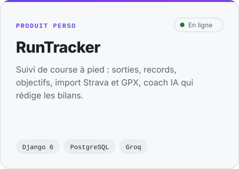
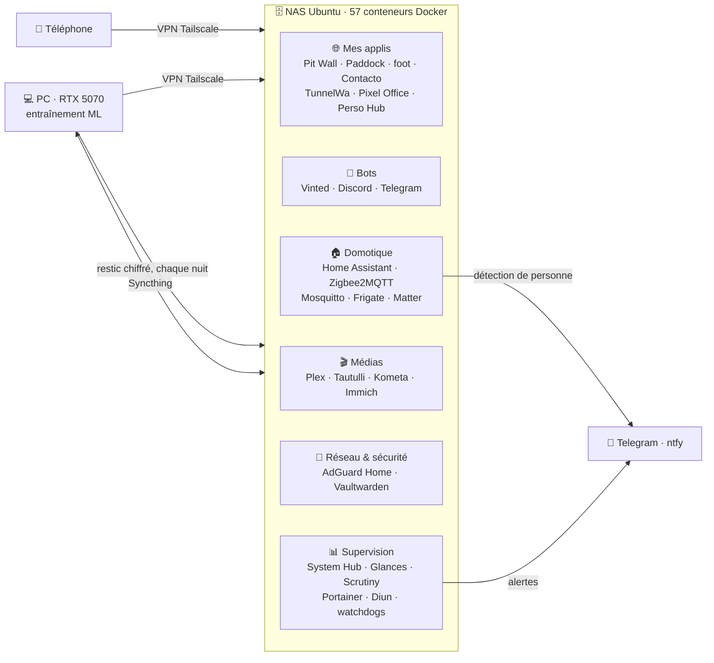

<!-- Visuels faits main : scripts/build_assets.py génère assets/*.svg (clair + sombre) -->
<picture>
  <source media="(prefers-color-scheme: dark)" srcset="assets/hero-dark.svg"/>
  
</picture>

 

Je conçois et livre des **applis web complètes** : back **Symfony, Django, Laravel ou Node**, front moderne, **IA intégrée** (RAG, recherche sémantique, agents), puis déploiement **Docker** jusqu'en prod.
En ce moment, en mission avec **Coteo** sur [Opalenews](https://www.opalenews.com/) et Contacto.

## Projets

Dépôts privés (projets clients et prod perso). Démo ou visite du code sur demande.

<a href="https://www.opalenews.com/"><picture><source media="(prefers-color-scheme: dark)" srcset="assets/card-opalenews-dark.svg"/></picture></a>
<picture><source media="(prefers-color-scheme: dark)" srcset="assets/card-contacto-dark.svg"/></picture>

<a href="https://runtracker.daens-elliott-projet-1.fr"><picture><source media="(prefers-color-scheme: dark)" srcset="assets/card-runtracker-dark.svg"/></picture></a>
<picture><source media="(prefers-color-scheme: dark)" srcset="assets/card-tunnelwa-dark.svg"/></picture>

<picture><source media="(prefers-color-scheme: dark)" srcset="assets/card-pitwall-dark.svg"/></picture>
<picture><source media="(prefers-color-scheme: dark)" srcset="assets/card-pixeloffice-dark.svg"/></picture>

<b>Plus de projets</b>

 

| Projet | Ce que c'est | Stack |
|:--|:--|:--|
| **Bot Vinted** | Pousse les nouvelles annonces Vinted sur Telegram en quelques secondes | aiogram 3 · httpx HTTP/2 · pydantic |
| **Jeu de fléchettes** | x01, Cricket, Shanghai, Killer… robots de niveau 1 à 10, stats, bilan IA | Flask · SQLite · JS |
| **Go Akademi** | Site vitrine d'un club de jiu-jitsu brésilien à Calais, avec back-office | Laravel 12 · Tailwind 4 |
| **L'Atelier** | Prise de rendez-vous en ligne : créneaux, espace client et admin | Laravel 13 · PHPUnit |
| **Bot Discord** | Modération, niveaux, classements, cartes de rang générées | discord.js 14 · SQLite |
| **Prompt Master** | Réécrit un prompt brut selon le guide Anthropic | FastAPI · Groq |
| **todo-relay** | Une todo par projet, saisie au téléphone, lue par Claude Code | FastAPI · Streamlit · MCP |
| **Perso Hub** | Habitudes, tâches, watchlist ciné (Letterboxd, TMDB) | Streamlit · plotly |

## Homelab

Tout mon perso tourne en prod sur un **NAS Ubuntu : 57 conteneurs Docker**. Le PC (RTX 5070) sert à entraîner les modèles.

<b>Ce qui tourne tout seul</b>

 

- **System Hub** (fait maison) : CPU, RAM, GPU, disques et conteneurs du NAS **et** du PC, avec historique
- **Watchdogs** : sauvegarde du PC absente depuis 48 h, capteurs Home Assistant, Zigbee hors ligne, disque à 90 %
- **Santé des disques** (Scrutiny) et **nouvelles versions d'images** (Diun)
- **Ménage Docker** chaque semaine, **ventilateur GPU** piloté par script (NVML)
- **Tri des médias** automatique dès qu'un fichier arrive
- **Sessions Claude Code** sur le NAS pour l'administration, toutes visibles dans Pixel Office

## Machine learning

Des modèles sur le sport, **mesurés contre une référence simple** plutôt que vendus au pourcentage flatteur.

| | Modèles | Résultat |
|:--|:--|:--|
| **F1** | Régression logistique, XGBoost calibré, Elo, Monte-Carlo (titre) | 2022-2025, 92 GP : **62 %** de vainqueurs trouvés contre 55 % pour « le poleman gagne » ; log-loss 1,08 contre 1,54 |
| **Ligue 1 & C1** | Poisson / Dixon-Coles sur les xG, Elo, pi-ratings | Log-loss 0,989 en walk-forward 2016-2025 : **au niveau des bookmakers** (0,983) |
| **MotoGP** | Régression logistique, gradient boosting | ~30 % de vainqueurs trouvés, contre 18 à 31 % pour les repères simples |
| **OpenTTD** | Apprentissage par renforcement (PPO masqué) | En cours : 250 M de pas, +545 000 £ en moyenne sur 48 parties |

## Stack

 

 

## Activité

<!-- Mise à jour chaque nuit par .github/workflows/metrics.yml -->

## Contact

Un site, une appli, une mission freelance ? Je réponds vite.

<a href="mailto:daenselliott691@gmail.com"><picture><source media="(prefers-color-scheme: dark)" srcset="assets/btn-mail-dark.svg"/></picture></a>
<a href="https://www.linkedin.com/in/elliott-daens-906b8b32a/"><picture><source media="(prefers-color-scheme: dark)" srcset="assets/btn-linkedin-dark.svg"/></picture></a>

Hors du code : jiu-jitsu brésilien, musculation, Formule 1, cinéma, gaming.
