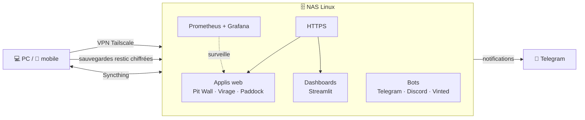

<!-- En-tête -->


<div align="center">

<a href="https://git.io/typing-svg"></a>

[](https://www.linkedin.com/in/elliott-daens-906b8b32a/)
[](mailto:daenselliott691@gmail.com)


</div>

### 👋 Salut, moi c'est Elliott

Développeur web **freelance full-stack**, basé en France 🇫🇷.
Je construis des applis web de bout en bout — du back **Symfony / Django / Laravel** jusqu'au déploiement **Docker** et à la mise en prod.

- 💼 En mission avec **Coteo** : [**Opalenews**](https://www.opalenews.com/) (en ligne) et **Contacto**
- 🚧 En chantier : un annuaire des pros de l'habitat en Hauts-de-France (pas encore en ligne)
- 🏠 Je fais tourner un **homelab** : NAS Linux, applis et bots en conteneurs Docker, VPN Tailscale, sauvegardes chiffrées
- 🤖 J'expérimente le **machine learning** (pronostics F1 et football) et les **agents IA** (Claude Code, MCP)
- 🌱 J'apprends : architecture MVC avancée, tests, CI/CD avec GitHub Actions
- 💬 Parlez-moi de : self-hosting, Docker, F1 🏎️, jiu-jitsu brésilien 🥋

```ts
const elliott = {
  role: "Développeur web freelance",
  client: "Coteo",
  formation: "DEUST WMI — Web, Multimédia & Informatique",
  stack: ["PHP/Symfony", "Python/Django", "Laravel", "JavaScript", "Docker"],
  ia: ["RAG", "embeddings", "Gemini", "Mistral"],
  aime: ["les applis rapides", "les serveurs qui ne tombent jamais", "les données"],
  horsCode: ["JJB", "muscu", "F1", "cinéma", "gaming"],
};
```

## 🛠️ Stack

<div align="center">

| | |
|:--|:--|
| **Front** |  |
| **Back** |  |
| **Données** |  |
| **Infra** |  |
| **Monitoring** |  |
| **Outils** |  |

</div>

## 🚀 Projets phares

> Mes dépôts sont privés (projets clients et prod perso). Visite du code ou démo sur demande 👉 [me contacter](mailto:daenselliott691@gmail.com).

<table>
<tr>
<td width="50%" valign="top">

### 🤝 Contacto · *avec Coteo*
Plateforme de mise en relation pour clubs et réseaux d'entreprises : profils, messagerie, fil d'actu, **campagnes e-mail et relances automatiques**, IA **Mistral**.
<br/><sub>Django · Celery · MySQL · Tailwind · Docker</sub>

</td>
<td width="50%" valign="top">

### 🌊 [Opalenews](https://www.opalenews.com/) · *avec Coteo*
Les événements de la Côte d'Opale : **recherche sémantique**, **assistant IA (RAG)**, carte interactive, site en FR / EN / NL, newsletter. **En ligne.**
<br/><sub>Symfony 8 · PHP 8.4 · PostgreSQL · Gemini · Pinecone · CI/CD</sub>

</td>
</tr>
<tr>
<td width="50%" valign="top">

### 🏎️ Pit Wall
Appli F1 : calendrier, classements et **pronostics par machine learning** du vainqueur de chaque Grand Prix.
<br/><sub>Python · ML · Docker</sub>

</td>
<td width="50%" valign="top">

### ⚽ Virage & Étoiles
Pronostics **Ligue 1** et **Ligue des champions** : modèles ML + deux applis web servies par le NAS.
<br/><sub>Python · ML · Streamlit</sub>

</td>
</tr>
<tr>
<td width="50%" valign="top">

### 👾 Pixel Office
Un bureau en **pixel art** où chaque session Claude Code devient un avatar : suivi en direct, chat et courrier entre agents.
<br/><sub>JavaScript · MCP</sub>

</td>
<td width="50%" valign="top">

### 🛒 Bot Vinted → Telegram
Surveille des recherches Vinted et envoie les nouvelles annonces sur Telegram en quelques secondes.
<br/><sub>Python · Telegram API</sub>

</td>
</tr>
</table>

## 🏠 Mon homelab

Tout ce que je développe tourne en prod chez moi, sur un NAS Linux piloté en Docker :



## 📊 Stats GitHub

<div align="center">

<!-- Mises à jour chaque nuit par .github/workflows/metrics.yml -->


<picture>
  <source media="(prefers-color-scheme: dark)" srcset="https://streak-stats.demolab.com?user=ElliottDaens&theme=github-dark-blue&hide_border=true&background=00000000&locale=fr"/>
  
</picture>

<details>
<summary><b>🗓️ Mon année en 3D</b></summary>
<br/>

</details>

<br/>

<!-- Généré chaque nuit par .github/workflows/snake.yml -->
<picture>
  <source media="(prefers-color-scheme: dark)" srcset="https://raw.githubusercontent.com/ElliottDaens/ElliottDaens/output/github-snake-dark.svg"/>
  
</picture>

</div>

## 🏋️ Hors du code

<div align="center">

🥋 **Jiu-jitsu brésilien** · 💪 **Musculation** · 🏎️ **Formule 1** · 🎥 **Cinéma** · 🎮 **Gaming**

</div>

## 📫 On en parle ?

<div align="center">

**Un site, une appli, une mission freelance ?** Écrivez-moi, je réponds vite 🚀

[](https://www.linkedin.com/in/elliott-daens-906b8b32a/)
[](mailto:daenselliott691@gmail.com)

</div>


